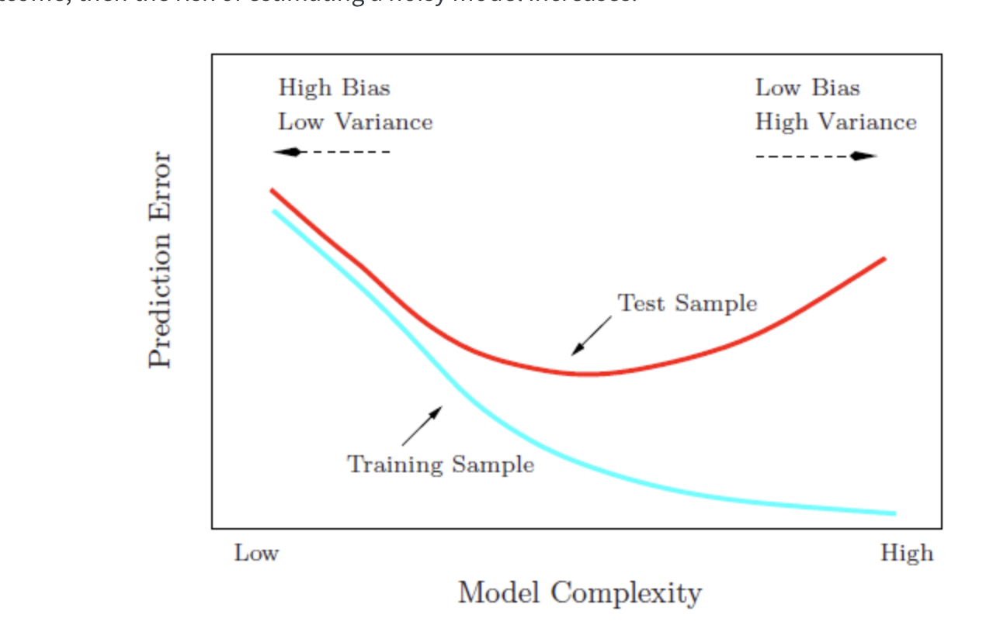

# K-Nearest Neighbors

*Week 2, 9 September*

Last week we distinguished four research goals. This week we begin working with prediction. We start with $K$-nearest neighbors because we can draw what it does. There is no probability theory or hidden optimization procedure to follow, and no coefficients to interpret. A picture lets us see how it produces predictions and where it runs into difficulty.

That visibility is useful while you are learning. Later in the block, the models will be harder to inspect. This first example gives us something concrete to compare them with.

Run the code as you work through the handout. We will assume it has run on your machine when we meet in the workshop.

## Fitting a function without assuming its shape

We often ask how an outcome varies with another variable: how $Y$ behaves conditional on $X$, written $P(Y=y \mid X=x)$.

One familiar approach is to assume a shape for the relationship and estimate its parameters. Ordinary least squares assumes a line; logit and probit assume particular shapes for binary outcomes. These are **parametric** models. Their usefulness depends partly on how well the assumed shape describes the relationship.

This approach gives us interpretable coefficients, standard errors, and a compact summary for a table. It also connects theoretical claims to quantities we can estimate. Much of the analysis in your other courses uses this framework.

The limitation is that more data will not fix an unsuitable shape. If the relationship curves, fitting a straight line to a thousand more observations still leaves us with a straight line.

We can respond by adapting the parametric model, perhaps through transformations, interactions, or logarithms. Alternatively, we can use a **non-parametric** method that makes fewer assumptions about the shape and lets the data play a larger role in determining it.

$K$-nearest neighbors is a simple example. Its prediction rule is:

> To predict the outcome for a case, find the $k$ cases in your data most similar to it, and average their outcomes. If the outcome is a category rather than a number, take the majority vote instead of the average.

There is no separate estimation step or set of fitted parameters in the usual sense. To make predictions, the model keeps and uses the data themselves.

## Drawing it: development and infant mortality

Last week's example concerned economic and political development. We established an association without settling its causal direction. We can set that causal question aside here, because prediction asks a different question.

Our dataset contains national development indicators for 199 countries and comes with the `carData` package.

```{r, eval=FALSE}
install.packages(c("carData", "kknn", "caret", "scatterplot3d"))
```

```{r, message=FALSE, warning=FALSE}
library(carData)
library(kknn)

options(scipen = 999)   # print numbers in full rather than as 1e+05

data(UN, package = "carData")

countries <- na.omit(UN[, c("ppgdp", "infantMortality", "fertility",
                            "pctUrban", "lifeExpF", "group")])

# Express per capita GDP in thousands of dollars
countries$ppgdp <- countries$ppgdp / 1000

nrow(countries)
head(countries)
```

`ppgdp` records gross domestic product per capita, and `infantMortality` records deaths per thousand live births.

There are two small adjustments in this chunk. `options(scipen = 999)` makes R print numbers in full, such as `100000` rather than `1e+05`. Dividing per capita GDP by a thousand keeps the axes readable. With this single predictor, changing the units cannot change which countries are nearest to one another, so it does not affect the model.

First, look at the data.

```{r}
plot(countries$ppgdp, countries$infantMortality,
     col = "gray45", pch = 19, cex = 0.7,
     xlab = "Per capita GDP (thousands of US$)",
     ylab = "Infant mortality (per 1,000 live births)")
```

Infant mortality falls steeply among the poorest countries and then levels off. Compare the difference between countries at \$500 and \$2,000 with the difference between those at \$30,000 and \$40,000.

Now fit a straight line.

```{r}
plot(countries$ppgdp, countries$infantMortality,
     col = "gray45", pch = 19, cex = 0.7,
     xlab = "Per capita GDP (thousands of US$)",
     ylab = "Infant mortality (per 1,000 live births)")

fit_ols <- lm(infantMortality ~ ppgdp, data = countries)
abline(fit_ols, col = "navy", lwd = 2.5)
```

The line misses the pattern systematically. It is too low for the poorest countries, too high in the middle, and eventually predicts negative infant mortality.

In a paper, we might address this within the parametric framework. Taking the logarithm of GDP per capita would straighten much of the curve. It also has a substantive interpretation: proportional differences in income may matter more than absolute differences.

Here we will use $K$-nearest neighbors, which does not require us to choose that shape in advance.

```{r}
grid <- data.frame(ppgdp = sort(countries$ppgdp))

fit_15 <- kknn(infantMortality ~ ppgdp,
               train = countries, test = grid,
               k = 15, kernel = "rectangular")

plot(countries$ppgdp, countries$infantMortality,
     col = "gray45", pch = 19, cex = 0.7,
     xlab = "Per capita GDP (thousands of US$)",
     ylab = "Infant mortality (per 1,000 live births)",
     main = "k = 15")

lines(grid$ppgdp, fit_15$fitted.values, col = "maroon", lwd = 3)
```

`kernel = "rectangular"` gives all $k$ neighbors equal weight. Other kernels give more weight to closer neighbors. We use the rectangular kernel because it matches the prediction rule described above.

### What the algorithm actually did

For a country with GDP per capita of \$2,000, the algorithm finds the fifteen countries closest to \$2,000 and averages their infant mortality. At \$3,000, it repeats the calculation with a slightly different set of neighbors.

The curve traces these moving averages. It depends on the observed neighbors rather than a separately estimated formula for the relationship.

This helps explain the wobbles where the data are sparse. There are few rich countries in the dataset, so their fifteen nearest neighbors may span a wide income range. The algorithm still produces a prediction, without warning us that the neighborhood may stretch across \$40,000.

## The choice of k

We chose fifteen neighbors without yet justifying that choice. Try several alternatives.

```{r}
plot(countries$ppgdp, countries$infantMortality,
     col = "gray75", pch = 19, cex = 0.7,
     xlab = "Per capita GDP (thousands of US$)",
     ylab = "Infant mortality (per 1,000 live births)",
     main = "The same data, four values of k")

kvals  <- c(3, 15, 50, 150)
kcols  <- c("darkred", "maroon", "navy", "darkgreen")

for (i in seq_along(kvals)) {
  f <- kknn(infantMortality ~ ppgdp,
            train = countries, test = grid,
            k = kvals[i], kernel = "rectangular")
  lines(grid$ppgdp, f$fitted.values, col = kcols[i], lwd = 2.5)
}

legend("topright", legend = paste("k =", kvals),
       col = kcols, lwd = 2.5, box.lty = 0, cex = 0.8)
```

At $k=3$, the curve follows local fluctuations closely. Some reflect the particular 199 countries in the dataset. At $k=150$, the curve is almost flat: averaging so broadly removes much of the observed difference between rich and poor countries.

These examples show two different ways a model can perform poorly.

A small $k$ follows small changes in the data. Some carry information about the relationship; others are noise. A model that reproduces the training data exactly also reproduces their noise, which need not recur in new cases.

We can express this by writing the outcome as

$$Y = \underbrace{f(X)}_{\text{signal}} + \underbrace{\varepsilon}_{\text{noise}}$$

We want to recover $f$. The term $\varepsilon$ includes measurement error, idiosyncrasy, and the particular histories of the countries observed here. Learning those details does not necessarily help us predict another sample.

The important distinction is between fitting the observations we already have and predicting new ones. **A perfect fit to the training data does not establish that a model will predict well.**

A large $k$ has the opposite problem. It averages over countries that differ substantially and can smooth away a relationship we want to retain.

## Why a perfect fit should worry you

To choose between these models, we need to evaluate them on observations excluded from fitting. We will split the data into a training set and a test set.

```{r}
set.seed(7)

n        <- nrow(countries)
train_id <- sample(1:n, floor(0.7 * n))

Train <- countries[train_id, ]
Test  <- countries[-train_id, ]

nrow(Train)
nrow(Test)
```

`set.seed()` fixes the random draw, so you and I obtain the same split. Use it for random operations so that you can reproduce the analysis later and others can follow it.

For a continuous outcome, a common measure of prediction error is the root mean squared error:

$$\text{RMSE} = \sqrt{\frac{1}{n}\sum_{i=1}^{n}\left[y_i - \hat{f}(x_i)\right]^2},$$

RMSE gives a sense of the size of prediction errors in the outcome's units. Here those units are deaths per thousand live births. An RMSE of 15 means errors are typically around fifteen deaths per thousand.

```{r}
rmse <- function(y, yhat) sqrt(mean((y - yhat)^2))

kseq     <- 2:60
err_test <- rep(NA, length(kseq))
err_train <- rep(NA, length(kseq))

for (i in seq_along(kseq)) {
  f_test <- kknn(infantMortality ~ ppgdp, Train, Test,
                 k = kseq[i], kernel = "rectangular")
  err_test[i] <- rmse(Test$infantMortality, f_test$fitted.values)

  f_train <- kknn(infantMortality ~ ppgdp, Train, Train,
                  k = kseq[i], kernel = "rectangular")
  err_train[i] <- rmse(Train$infantMortality, f_train$fitted.values)
}

plot(kseq, err_test, type = "l", col = "maroon", lwd = 2.5,
     ylim = range(c(err_test, err_train)),
     xlab = "k", ylab = "RMSE",
     main = "Error on data the model has seen, and data it has not")

lines(kseq, err_train, col = "navy", lwd = 2.5)

legend("bottomright", legend = c("Test (unseen)", "Training (seen)"),
       col = c("maroon", "navy"), lwd = 2.5, box.lty = 0, cex = 0.8)

kseq[which.min(err_test)]
```

Compare the training and test curves.

Training error falls as $k$ gets smaller and is lowest on the left, where the model is most flexible. Choosing from training error alone would favor the most flexible model in this comparison.

Test error initially falls, reaches a minimum, and rises again. Beyond that minimum, the model is fitting details of the training countries that do not help with the test countries.

Before choosing $k$, change the seed and rerun the code. The broad U shape remains, but the minimum moves. Avoid treating "the optimal $k$ is 11" as a substantive finding about infant mortality: it depends on the split. We will use cross-validation to make the choice less dependent on one draw.

### The same picture, drawn the conventional way

The horizontal axis makes this plot a little awkward. A large $k$ gives a *simpler* model, so complexity increases toward the *left*. Textbooks usually draw complexity increasing to the right.

Plotting against $\log(1/k)$ gives us that orientation, since it increases with model flexibility.

```{r}
plot(log(1 / kseq), err_test, type = "l", col = "maroon", lwd = 2.5,
     ylim = range(c(err_test, err_train)),
     xlab = "Model complexity, log(1/k)", ylab = "RMSE",
     main = "Complexity increases to the right")

lines(log(1 / kseq), err_train, col = "navy", lwd = 2.5)

text(log(1 / 60), err_test[length(kseq)], "k = 60", pos = 4, cex = 0.8, col = "gray30")
text(log(1 / 2),  err_test[1],            "k = 2",  pos = 2, cex = 0.8, col = "gray30")

legend("top", legend = c("Test (unseen)", "Training (seen)"),
       col = c("maroon", "navy"), lwd = 2.5, box.lty = 0, cex = 0.8)
```

The numbers and conclusion are unchanged. We have simply redrawn them so that moving right means a more flexible model. This is the conventional picture: training error falls with complexity, while test error eventually turns upward.

## Bias and variance

The terms **bias** and **variance** help us describe the two problems in this picture. You will encounter them throughout the statistical-learning literature.

Return to our earlier decomposition:

$$Y = \underbrace{f(X)}_{\text{signal}} + \underbrace{\varepsilon}_{\text{noise}}$$

There are two ways our estimate of $f$ can go wrong.

**Bias** is systematic error. A model may be too rigid to capture the shape of $f$, so additional observations do not resolve the problem. Our straight line through the infant mortality data is an example. So is $K$-nearest neighbors at $k=150$, which smooths the curve into something almost horizontal.

**Variance** concerns how much the fitted model changes across samples. A model flexible enough to represent $f$ may follow the observations so closely that another sample gives a noticeably different fit. The answer from one sample can then be unreliable even without systematic error in one direction.

Reducing one often increases the other. This trade-off helps explain the U-shaped test-error curve.



This figure is a schematic rather than an analysis of a particular dataset. It illustrates the pattern we have just examined.

The arrows show the trade-off. Moving left gives simpler models, generally reducing variance but increasing bias. Moving right gives more flexible models, generally reducing bias but increasing variance. Training error falls throughout, so it does not help us locate the minimum of test error.

### Seeing variance directly

With real data, separating bias from variance is difficult because we do not know the true $f$. We cannot directly measure how far each fitted model is from $f$.

Simulation lets us examine this. We choose a function, add noise, draw repeated samples, and fit a model to each. Since we know the function, we can compare every fit with it.

```{r, fig.height=7, fig.width=10}
set.seed(1364)

N <- 1000
x <- rnorm(N, 2, 1)
f_true <- function(x) cospi(x)
y <- f_true(x) + rnorm(N, 0, 0.5)

sim   <- data.frame(x, y)
grid2 <- data.frame(x = sort(x))

kvec   <- c(5, 40, 150)
nsim   <- 30
ntrain <- 200
spot   <- 400                       # one x value we will watch closely
x_spot <- grid2$x[spot]

par(mfrow = c(2, 3))

preds <- matrix(NA, nsim, length(kvec))

for (j in seq_along(kvec)) {

  plot(x, y, col = "gray70", pch = 1, cex = 0.5,
       main = paste("k =", kvec[j]), font.main = 1)

  for (i in 1:nsim) {
    draw <- sim[sample(1:N, ntrain), ]
    f    <- kknn(y ~ x, draw, grid2, k = kvec[j], kernel = "rectangular")
    lines(grid2$x, f$fitted.values, col = "royalblue2", lwd = 0.4)
    preds[i, j] <- f$fitted.values[spot]
  }

  abline(v = x_spot, col = "gray40", lty = 2)
}

for (j in seq_along(kvec)) {
  boxplot(preds[, j], ylim = range(preds), col = "gray90",
          main = paste("Predictions at one point, k =", kvec[j]),
          font.main = 1, cex.main = 0.9)
  abline(h = f_true(x_spot), col = "red", lwd = 2)
}
```

These plots use thirty samples and three values of $k$, all drawn from the same underlying function. The red line in the lower row marks the true value at the point being examined.

At $k=5$, the fitted curves vary widely across samples. Their predictions are centered roughly on the true value, so bias is small, but an individual prediction may be far away. This is high variance.

At $k=150$, the curves are very similar across samples. The estimates are stable, but the box lies far from the red line: they are consistently missing the true value. This is high bias.

At $k=40$, the predictions are both reasonably concentrated and close to the true value, giving a better balance in this example.

Keep this in mind when reading a fitted model. A high-variance model may look convincing on the data used to fit it, without showing how much the result would change in another sample.

## Cross-validation

Our choice of $k$ depended on a single training/test split and moved when we changed the seed. There are two limitations to that approach:

1. The choice depends on which observations happen to be in each set.
2. We exclude thirty percent of the countries from training. With only 199 cases, that is a substantial amount of information.

**Cross-validation** addresses these limitations by rotating which observations are held out.

### Leave-one-out

Leave one observation out, train on the remaining $n-1$, predict the omitted case, and record its error. Repeat this $n$ times, then combine the errors.

$$\text{RMSE}_{\text{LOO}} = \sqrt{\frac{1}{n}\sum_{i=1}^{n}\left(y_i - \hat{y}_i\right)^2}$$

Each case is used for testing once and for training in all the other fits. This removes dependence on one arbitrary split, but requires fitting the model $n$ times.

### k-fold

In k-fold cross-validation, we hold out groups rather than individual observations. Divide the data randomly into roughly equal folds. Train on all but the first fold and evaluate on that fold, then repeat with each of the others. Combine the errors after every fold has been used for testing.

```{r, echo=FALSE, fig.height=4.5}
nf <- 5

plot(NULL, xlim = c(0, 11), ylim = c(0, nf + 1.4),
     axes = FALSE, xlab = "", ylab = "",
     main = "5-fold cross-validation", font.main = 1)

for (row in 1:nf) {
  ypos <- nf - row + 1
  for (col in 1:nf) {
    held <- (col == row)
    rect(col * 1.6, ypos - 0.32, col * 1.6 + 1.5, ypos + 0.32,
         col = if (held) "gray55" else "white", border = "gray25")
  }
  text(1.4, ypos, paste("Round", row), pos = 2, cex = 0.85)
  text(nf * 1.6 + 1.9, ypos, bquote(E[.(row)]), pos = 4, cex = 0.9)
}

text(5.6, nf + 1.0, "each block is one fold of the data", cex = 0.85, col = "gray30")
legend("bottom", legend = c("trained on", "held out and tested on"),
       fill = c("white", "gray55"), border = "gray25",
       box.lty = 0, cex = 0.85, horiz = TRUE)
```

$$\text{CV RMSE} = \sqrt{\frac{1}{\text{nfold}}\sum_{f=1}^{\text{nfold}} \text{MSE}_f}$$

**Watch the two uses of the letter $k$.** The number in "$k$-fold" is unrelated to the $k$ in "$K$-nearest neighbors." We will use one to choose the other, so the code calls the fold count `nfold` to keep them apart.

```{r}
cv_knn <- function(data, kvals, nfold = 10, seed = 7) {

  set.seed(seed)
  fold <- sample(rep(1:nfold, length.out = nrow(data)))
  out  <- rep(NA, length(kvals))

  for (j in seq_along(kvals)) {

    fold_mse <- rep(NA, nfold)

    for (f in 1:nfold) {
      tr  <- data[fold != f, ]
      te  <- data[fold == f, ]
      fit <- kknn(infantMortality ~ ppgdp, tr, te,
                  k = kvals[j], kernel = "rectangular")
      fold_mse[f] <- mean((te$infantMortality - fit$fitted.values)^2)
    }

    out[j] <- sqrt(mean(fold_mse))
  }

  out
}
```

You do not need to write this loop from scratch. You should be able to read it and explain what it does. That is the general expectation for code in this course.

```{r}
kseq2  <- 2:60

cv_5  <- cv_knn(countries, kseq2, nfold = 5)
cv_10 <- cv_knn(countries, kseq2, nfold = 10)

plot(kseq2, cv_10, type = "l", col = "maroon", lwd = 2.5,
     ylim = range(c(cv_5, cv_10)),
     xlab = "k", ylab = "Cross-validated RMSE",
     main = "Choosing k by cross-validation")

lines(kseq2, cv_5, col = "navyblue", lwd = 2.5)

abline(v = kseq2[which.min(cv_10)], lty = 2, col = "maroon")

legend("topleft", legend = c("10-fold", "5-fold"),
       col = c("maroon", "navyblue"), lwd = 2.5, box.lty = 0, cex = 0.8)

kseq2[which.min(cv_5)]
kseq2[which.min(cv_10)]
```

Compared with the single-split curve, this one is smoother because each point combines errors from several held-out sets. The two fold counts also give broadly similar results.

Cross-validation does not identify a uniquely correct $k$. Several values may perform similarly, and the exact minimum of a flat curve can reflect noise. Report the range of plausible choices, the value you selected, and your reason for selecting it.

### The same thing, with caret

In practice, a package can handle this loop. Now that we have worked through cross-validation, we will use `caret` to implement it.

`caret` provides a common R interface for fitting and comparing predictive models. Install it now; we will use it again in Week 6.

```{r, eval=FALSE}
install.packages("caret")
```

```{r, message=FALSE, warning=FALSE}
library(caret)

set.seed(7)

cv_caret <- train(
  infantMortality ~ ppgdp,
  data       = countries,
  method     = "knn",
  preProcess = c("range"),
  trControl  = trainControl(method = "cv", number = 10),
  tuneGrid   = data.frame(k = kseq2)
)

cv_caret$bestTune

plot(cv_caret)
```

Four arguments correspond to the steps we carried out by hand.

`method = "knn"` selects the algorithm. `caret` supports well over a hundred methods. Next week, we will change this argument to fit a random forest.

`trControl = trainControl(method = "cv", number = 10)` specifies cross-validation. `number` is the fold count, which we called `nfold`. Setting `method = "LOOCV"` requests leave-one-out cross-validation instead.

`tuneGrid = data.frame(k = kseq2)` supplies the values of $k$ to compare. Without it, `caret` tries three values of its own choosing, which may not cover the range we want.

`preProcess = c("range")` rescales features to lie between zero and one, using the first of the two formulas from the previous section. You must request this explicitly; otherwise `caret` uses the raw units.

With one predictor, this rescaling does not change which countries are nearest to one another. We include it because scaling becomes important once we add a second feature, and it is useful to establish the habit now.

The result should be close to the loop's choice, though `caret` draws its own folds. If the choices differ by a few units of $k$ on a flat curve, that need not indicate a substantive disagreement.

Week 6 extends evaluation to rare outcomes, where accuracy can be misleading and we need other metrics.

## More than one feature, and the problem of units

With multiple features, similarity needs a definition of distance. A common choice is Euclidean distance. For a case $f$ with features $(x_{f1}, \dots, x_{fp})$ and a training case $i$, it is

$$d_{if} = \sqrt{\sum_{j=1}^{p}\left(x_{fj} - x_{ij}\right)^2}.$$

This extends straight-line distance to more than two dimensions. It also makes the units of our features important.

GDP per capita ranges from well under one to about a hundred, measured in thousands of dollars. Percent urban ranges from zero to a hundred, fertility from about one to seven, and female life expectancy from the high forties to the high eighties.

```{r}
summary(countries[, c("ppgdp", "pctUrban", "fertility", "lifeExpF")])
```

Using these raw units gives the wide-ranging features much more influence on distance. An income difference of fifty contributes two and a half thousand to the sum under the square root. The full fertility range contributes only about thirty-five. Features measured on smaller scales have very little influence, even if they are substantively relevant.

We can put features on a common scale using either of these transformations:

$$\tilde{x} = \frac{x - \min(x)}{\max(x) - \min(x)} \qquad \text{or} \qquad \tilde{x} = \frac{x - \bar{x}}{\sigma_x}.$$

```{r}
rescale <- function(x) (x - min(x)) / (max(x) - min(x))

feats <- c("ppgdp", "pctUrban", "fertility", "lifeExpF")

countries_s <- countries
countries_s[feats] <- lapply(countries_s[feats], rescale)

summary(countries_s[, feats])
```

First, compare each feature with the outcome before and after rescaling. The transformation preserves that relationship.

```{r, fig.height=8, fig.width=9}
par(mfrow = c(2, 2))

plot(countries$ppgdp, countries$infantMortality, col = "maroon", cex = 0.7,
     xlab = "Per capita GDP (thousands of US$)", ylab = "Infant mortality",
     main = "Raw units", font.main = 1)
plot(countries_s$ppgdp, countries_s$infantMortality, col = "maroon", cex = 0.7,
     xlab = "Per capita GDP (rescaled 0 to 1)", ylab = "Infant mortality",
     main = "Rescaled", font.main = 1)

plot(countries$pctUrban, countries$infantMortality, col = "maroon", cex = 0.7,
     xlab = "Percent urban", ylab = "Infant mortality",
     main = "Raw units", font.main = 1)

plot(countries_s$pctUrban, countries_s$infantMortality, col = "maroon", cex = 0.7,
     xlab = "Percent urban (rescaled 0 to 1)", ylab = "Infant mortality",
     main = "Rescaled", font.main = 1)
```

The shapes of the point clouds are unchanged. Only the horizontal-axis numbers differ.

The change that matters for the model concerns the joint feature space, which these separate plots do not show.

### What the algorithm now sees

With two features, countries sit in a plane rather than on a line, and we can plot the outcome above that plane.

```{r, fig.height=7, fig.width=7}
library(scatterplot3d)

scatterplot3d(countries_s$ppgdp, countries_s$pctUrban, countries_s$infantMortality,
              color = "maroon", pch = 1, cex.symbols = 0.7,
              xlab = "Per capita GDP (rescaled)",
              ylab = "Percent urban (rescaled)",
              zlab = "Infant mortality")
```

Adding a third feature makes this picture harder to draw, because the outcome would require another dimension. The distance formula still works with any number of features. For more complex models, we will need to reason about spaces we cannot visualize directly.

### What the neighborhood looks like

Choose a country and compare the twenty-five neighbors selected using raw units with those selected after rescaling.

```{r, fig.height=6, fig.width=11}
target_raw <- c(median(countries$ppgdp),   median(countries$fertility))
target_s   <- c(median(countries_s$ppgdp), median(countries_s$fertility))

# Euclidean distance, exactly the formula above, computed by hand
dist_raw <- sqrt((countries$ppgdp     - target_raw[1])^2 +
                 (countries$fertility - target_raw[2])^2)

dist_s   <- sqrt((countries_s$ppgdp     - target_s[1])^2 +
                 (countries_s$fertility - target_s[2])^2)

nb_raw <- order(dist_raw)[1:25]
nb_s   <- order(dist_s)[1:25]

par(mfrow = c(1, 2))

plot(countries$ppgdp, countries$fertility, col = "gray55", pch = 19, cex = 0.7,
     xlab = "Per capita GDP (thousands of US$)", ylab = "Fertility (births per woman)",
     main = "Raw units, k = 25", font.main = 1)
points(countries$ppgdp[nb_raw], countries$fertility[nb_raw], col = "red", cex = 1.6)
points(target_raw[1], target_raw[2], col = "red", pch = 19, cex = 1.7)
abline(v = target_raw[1], h = target_raw[2], col = "darkgreen", lty = 2)

plot(countries_s$ppgdp, countries_s$fertility, col = "gray55", pch = 19, cex = 0.7,
     xlab = "Per capita GDP (rescaled)", ylab = "Fertility (rescaled)",
     main = "Rescaled, k = 25", font.main = 1)
points(countries_s$ppgdp[nb_s], countries_s$fertility[nb_s], col = "red", cex = 1.6)
points(target_s[1], target_s[2], col = "red", pch = 19, cex = 1.7)
abline(v = target_s[1], h = target_s[2], col = "darkgreen", lty = 2)
```

The filled red point is our target country. The circled points are the twenty-five countries selected as its neighbors.

On the right, the rescaled features produce a roughly disc-shaped neighborhood. Both features contribute to the selection.

On the left, the neighbors form a narrow vertical band. They have incomes close to the target's but span much of the fertility range. Income ranges over about a hundred units while fertility ranges over about six, so a small income difference can outweigh a large fertility difference. The units give income most of the influence without any explicit judgment that fertility matters less.

Both models return predictions without warnings. We could report the raw-unit version as a two-feature model even though one feature contributes very little. To notice that, we need to inspect the neighborhood.

This matters beyond the calculation. The model's definition of similarity depends on which features we include and how we scale them. Leaving the raw units in place gives income much more influence. That is a consequence of our setup, even if we never explicitly intended to define similarity that way.

## What this model cannot tell you

There are no coefficients or standard errors to summarize this model, and no statement such as "a one-unit increase in $X$ is associated with a change in $Y$." Its predictions depend on the data it retains.

The model also does not explain *why* richer countries have lower infant mortality. It uses the association between income and mortality to predict, as we discussed last week. Predicting well does not turn that association into an explanation.

Another limitation appeared in the neighborhood plots. The model returns predictions in the same format whether a case has many close neighbors or lies at the edge of the data. For the richest country, the neighbors may span tens of thousands of dollars in income. The output alone does not distinguish that prediction from one based on twenty-five closely comparable countries.

## The politics of similarity

The model applies a simple rule: cases similar to past cases receive outcomes based on those past cases.

This resembles precedent in law, case-based administrative reasoning, and the Weberian ideal of treating similar cases alike. Consistency can support predictable, accountable administration, regardless of who handles a case.

With a fitted model, we should ask who defines similarity and how visible that definition is. In $K$-nearest neighbors, feature selection and rescaling determine it. These early technical decisions may receive little documentation or attention once a system is running, even though they shape its treatment of cases.

The model also reproduces patterns in the cases it was given. If those cases record unjust treatment, the model can carry that treatment forward while appearing consistent. This can happen even when the system operates as designed.

## Reading

James, G., Witten, D., Hastie, T., and Tibshirani, R. *An Introduction to Statistical Learning*. Sections 2.1 and 2.2, Section 3.5, and Section 5.1. Freely available at [statlearning.com](https://www.statlearning.com/) [@james2021].

Read Section 2.2 with particular attention to the figures. Compare its training/test error and bias-variance pictures with the ones you produced here. Section 5.1 gives a short explanation of cross-validation.

## Before the workshop

Install `carData`, `kknn`, `caret`, and `scatterplot3d`, run every chunk, and bring a charged laptop. Please check installation at home so we can use the three-hour workshop for the material itself.

If something does not run, let me know at the start of the session so we can address it.

## Questions for the session

Prepare an answer to at least two questions. We will use them to begin the session.

1. $K$-nearest neighbors has no coefficients and makes no claim about mechanism. Is it therefore useless for political science, or is that the wrong test to apply to it? Last week's reading is relevant here.

2. The choice of $k$ has no correct answer that can be read off the data alone. What does it mean that a central decision in a model is made by the researcher rather than discovered?

3. We rescaled the features so that income would not dominate the distance calculation. Suppose someone had not. Would you describe the resulting model as wrong, or as encoding a particular view of what makes two countries similar? Does the distinction matter for how such a system should be reviewed?

4. In the neighborhood figures, the left-hand model was given two features and used essentially one. It returned predictions and printed no warning. What follows for how a system you did not build should be reviewed before anyone relies on its outputs?

5. The model returns a prediction for the richest country in the data, assembled from neighbors that are nothing like it, and reports it exactly as it reports any other. Where in political or administrative use would that distinction matter most, and what would a responsible system do instead?

6. Bureaucratic rule-following and nearest-neighbor prediction both treat like cases alike. Identify one political difference between them that is not simply that the model is more complicated.