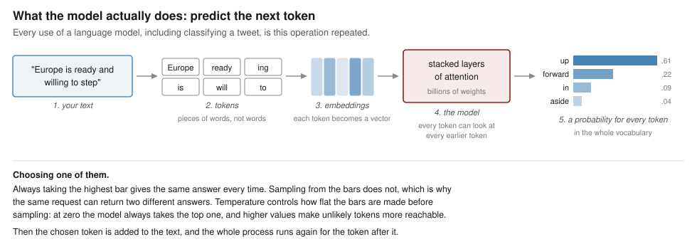
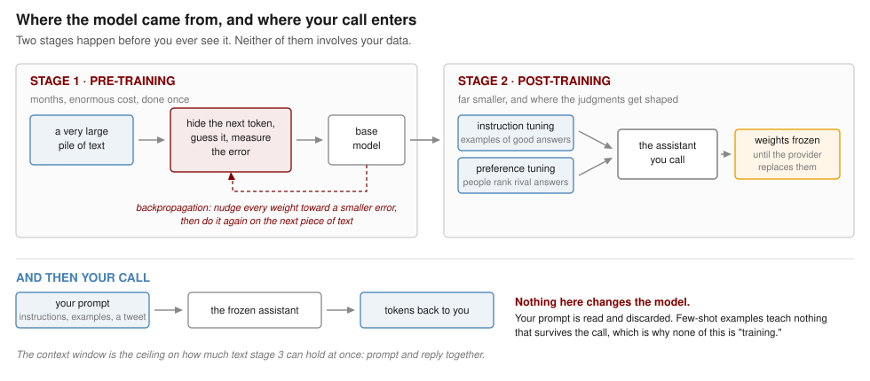

# Large Language Models

*Week 5, 30 September*

Over the last three weeks, we have used supervised methods to predict outcomes from labeled cases. We chose categories, supplied examples, and evaluated predictions on cases excluded from fitting. Neighbors, trees, and word rates implemented this in different ways.

This week we explore two alternatives.

First, we try an unsupervised model. If we do not know which distinctions to look for in a corpus, we can ask a model to find structure, then assess whether its groupings are useful. We still have to interpret and name them, so this changes where the coding decisions occur.

Second, we use a large language model. We can describe categories in English and ask it to apply them without fitting it to our own labeled training data. We will examine both the convenience of this approach and its limitations.

## Part I. Categories you did not supply

### Supervised and unsupervised

Our methods so far have been **supervised**: each training case had a known outcome. The model learned to reproduce those outcomes, and we evaluated it by comparing its predictions with held-out labels.

**Unsupervised** methods look for structure without supplied outcomes. They may identify similar documents or words that often occur together. There are no correct labels against which to calculate the same kind of accuracy score, so we need other ways to evaluate the result.

A common approach in political text analysis is **topic modeling**, particularly Latent Dirichlet Allocation (LDA). It represents each document as a mixture of topics and each topic as a distribution over words. Fitting estimates both distributions together.

An unsupervised model can return plausible-looking output even when it is unhelpful. We begin with an example of that problem.

### The corpus, and a subset of it

```{r, eval=FALSE}
install.packages(c("tm", "SnowballC", "topicmodels", "slam", "ggplot2"))
```

```{r, message=FALSE, warning=FALSE}
library(tm)
library(SnowballC)
library(topicmodels)
library(slam)
library(ggplot2)

url <- paste0("https://raw.githubusercontent.com/babakrezaee/",
              "AppliedAI-PoliSci/refs/heads/main/data/",
              "trump_2019_all.csv")

all <- read.csv(url, stringsAsFactors = FALSE, na.strings = "")

nrow(all)

table(all$label, useNA = "ifany")
```

This corpus contains every original tweet from 2019 after removing retweets, link-only tweets, and duplicates. Last week's 905 tweets are a **subset**, marked by the `label` column. The other three thousand have no hand labels.

We use the same cleaning pipeline as Week 4.

```{r, message=FALSE, warning=FALSE}
corpus <- VCorpus(VectorSource(all$text))

replace_with_space <- content_transformer(function(x, pattern) {
  gsub(pattern, " ", x)
})

clean <- tm_map(corpus, content_transformer(tolower))
clean <- tm_map(clean, replace_with_space, "http[s]?://\\S*")
clean <- tm_map(clean, replace_with_space, "@\\S+")
clean <- tm_map(clean, replace_with_space, "[^a-z ]")
clean <- tm_map(clean, removeWords, stopwords("english"))
clean <- tm_map(clean, stemDocument)
clean <- tm_map(clean, stripWhitespace)

dtm <- DocumentTermMatrix(clean)

dtm
```

Some tweets contain almost nothing beyond links and handles. Cleaning leaves them with no words, producing zero rows. `LDA()` cannot fit those rows, so we remove them first.

```{r}
keep <- row_sums(dtm) > 0

sum(!keep)
```

### A first attempt, on last week's corpus

First, fit the model to the familiar subset of 905 hand-labeled tweets.

```{r}
wk4 <- which(!is.na(all$label) & keep)

length(wk4)

lda_wk4 <- LDA(dtm[wk4, ], k = 6, control = list(seed = 7))

terms(lda_wk4, 10)
```

Look at the six columns and try to name the topics before reading further.

Naming them is difficult. Every column contains `border` or `wall`, along with words such as `will`, `great`, `democrat`, and `presid`. The six topics look very similar. The model ran without a warning and returned the expected format, but the result is not useful for separating subjects.

### Why, and what that tells you

To understand this result, look at how the corpus was assembled.

```{r}
probe <- as.matrix(dtm[, c("border", "wall", "mexico")]) > 0

round(100 * colMeans(probe[wk4, ]), 1)

round(100 * colMeans(probe[keep, ]), 1)
```

`border` occurs in roughly three of every ten tweets in the Week 4 corpus, compared with fewer than one in ten across the full year. We included all immigration tweets and deliberately chose negative examples containing near misses such as *border*, *wall*, and *illegal*. That construction made a useful Naive Bayes exercise, but gives the topic model little topical diversity to separate.

**The corpus shapes an unsupervised result as much as the method does.** Supervised evaluation can reveal poor performance against labels. Here we receive six well-formatted columns and have to assess their usefulness ourselves. Readers also need enough information about the corpus to make that assessment.

### The same model, the whole year

```{r}
lda_all <- LDA(dtm[keep, ], k = 6, control = list(seed = 7))

terms(lda_all, 10)
```

The full-year topics differ more clearly. Alongside the border debate, this corpus contains impeachment, the Mueller report, trade with China, the economy, rallies, and endorsements.

### Reading the model properly

`terms()` is a convenient summary. The estimates themselves are in two matrices. We will extract them because they supply the quantities for the following figures.

```{r}
post <- posterior(lda_all)

beta <- post$terms     # 6 topics by vocabulary: word probabilities within a topic
gamma <- post$topics   # documents by 6 topics: topic shares within a document

dim(beta)

dim(gamma)
```

### The top words in each topic

```{r, fig.height=7, fig.width=9}
top <- data.frame()

for (k in 1:6) {
  o <- order(beta[k, ], decreasing = TRUE)[1:10]
  top <- rbind(top, data.frame(topic = k,
                               term  = colnames(beta)[o],
                               beta  = beta[k, o]))
}

top$lab <- factor(paste(top$topic, top$term),
                  levels = rev(paste(top$topic, top$term)))

ggplot(top, aes(beta, lab)) +
  geom_col(fill = "steelblue") +
  facet_wrap(~ topic, scales = "free_y") +
  scale_y_discrete(labels = function(x) sub("^[0-9]+ ", "", x)) +
  labs(x = "probability of the word within the topic", y = NULL,
       title = "Most probable words in each topic")
```

This plot adds probabilities to the top words printed by `terms()`. The steep drop in bar height shows that two or three words carry much of each displayed topic's probability, while the remaining top words contribute less.

### The words that actually separate the topics

The most probable words are not always the most useful for distinguishing topics. Words such as `will` and `great` are common across the corpus and appear near the top of several topics.

Instead, ask which words are **more likely in a topic than in the corpus overall**.

```{r, fig.height=7, fig.width=9}
p_corpus <- col_sums(dtm[keep, ])
p_corpus <- p_corpus / sum(p_corpus)
p_corpus <- p_corpus[colnames(beta)]

lift <- sweep(log2(beta), 2, log2(p_corpus), "-")

lift[beta < 0.0015] <- NA   # ignore words too rare to be worth reporting

dist <- data.frame()

for (k in 1:6) {
  o <- order(lift[k, ], decreasing = TRUE, na.last = NA)[1:10]
  dist <- rbind(dist, data.frame(topic = k,
                                 term  = colnames(lift)[o],
                                 lift  = lift[k, o]))
}

dist$lab <- factor(paste(dist$topic, dist$term),
                   levels = rev(paste(dist$topic, dist$term)))

ggplot(dist, aes(lift, lab)) +
  geom_col(fill = "maroon") +
  facet_wrap(~ topic, scales = "free_y") +
  scale_y_discrete(labels = function(x) sub("^[0-9]+ ", "", x)) +
  labs(x = "log2 times more likely in this topic than in the corpus", y = NULL,
       title = "Most distinctive words in each topic")
```

A value of 2 means a word is four times more likely in the topic than in the whole corpus. This comparison reduces the prominence of shared vocabulary and highlights differences.

There are two cautions. I chose the threshold `0.0015` to exclude very rare words with high lift; it is arbitrary, so try changing it. Also, distinctiveness and importance are different properties. Read this plot alongside the probability plot.

::: callout-tip
Try the distinctiveness plot on `lda_wk4`. The short bars and similar words across panels make its limited separation easier to see than the printed table does.
:::

### Documents are mixtures, not members

LDA has not assigned each tweet to one box. Each tweet has a share of every topic, and those shares sum to one.

```{r, fig.height=5, fig.width=8}
gdf <- data.frame(topic = factor(rep(1:6, each = nrow(gamma))),
                  gamma = as.vector(gamma))

ggplot(gdf, aes(topic, gamma)) +
  geom_boxplot(fill = "grey90", outlier.size = 0.4, outlier.alpha = 0.3) +
  labs(x = "topic", y = "share of a document belonging to this topic",
       title = "How much of each document belongs to each topic")
```

The long upper tails suggest that many tweets are dominated by one topic, while others have substantial shares of several. Unlike Naive Bayes's single label or a tree's single path, this allows a tweet to be sixty percent one topic and forty percent another. Such mixtures can better describe political text, though they are harder to summarize in a simple table.

### Against the hand labels

We have human labels for 905 tweets, so we can compare the topic structure with a category defined by a coder. Many topic-model applications lack this comparison.

```{r, fig.height=5, fig.width=7}
lab <- all$label[keep]
assigned <- topics(lda_all)

tab <- table(topic = assigned[!is.na(lab)], label = lab[!is.na(lab)])

hdf <- as.data.frame(prop.table(tab, 2))

ggplot(hdf, aes(label, topic, fill = Freq)) +
  geom_tile(colour = "white") +
  geom_text(aes(label = sprintf("%.0f%%", 100 * Freq)), size = 3.4) +
  scale_fill_gradient(low = "white", high = "steelblue") +
  labs(x = NULL, y = "topic", fill = "share of\ncolumn",
       title = "Where the hand-coded tweets land")
```

Read the figure by column. Immigration tweets concentrate in one or two topics, but those topics also contain tweets labeled `other`.

The labels and topics are related but answer different questions. The coder decided whether immigration was a main subject of each tweet. LDA estimated patterns of word co-occurrence across the corpus. We should not expect the two to coincide exactly.

### Naming, and what naming costs

The figures do not supply topic names. LDA returns numbered word distributions; calling topic 3 "immigration" requires our interpretation of the words.

Unsupervised learning therefore moves some coding decisions to after the analysis. We should report those decisions clearly, since a topic name can otherwise look like something the model discovered on its own.

Two other choices remain ours. I set `k` to six; the data did not determine that value. With twenty topics, the border, caravan, and wall might appear separately rather than together. Cleaning also matters because stemming and stopwords determine which words are available to define the topics.

Topic models are useful for exploring a corpus we have not read in full. Their topics are not automatically measurements of a predefined concept. Treating them that way requires further justification and validation.

## Part II. What a language model is

Before calling a language model, we need a basic account of how it works. We will leave the mathematics aside and focus on ideas that help explain its behavior in the exercise.

### One operation, repeated

A language model assigns probabilities to possible next pieces of text given the preceding text. A selection process chooses one, and the operation repeats.



The figure introduces four terms we will use.

A **token** is a unit of text, often part of a word. For example, *willing* may be split into `will` and `ing`, while an unusual name may take several tokens. Token counts also determine billing.

An **embedding** represents a token as a vector. Similar uses of words can produce similar vectors, helping the model relate *protest* to *demonstration*. The intuition resembles Week 2's distances, but these coordinates are learned rather than measured directly.

**Attention** lets a token's representation incorporate the surrounding tokens. This helps distinguish *bank* in a river sentence from *bank* in a financial sentence. It is a central architectural feature of these models.

The **context window** is the amount of text the model can work with at once, including prompt and answer. Text outside that window is unavailable for the current response.

Classification, summarization, translation, and code generation use this same repeated operation under different prompts. When we request a sentiment label, the model generates a continuation consistent with that request rather than consulting a separate sentiment module.

### Where it came from

The model has already undergone training before it answers our call. Two stages are useful to distinguish.



During **pre-training**, the model repeatedly predicts the next token in a large volume of text. **Backpropagation** calculates how its weights contributed to the error and adjusts them to reduce it. Through this process, the model acquires patterns of grammar, facts, and style. It also reflects the distribution of its training material, including which voices are common and which are scarce.

The resulting **base model** predicts plausible continuations but is not yet shaped for assistant-style conversation. For example, it may continue a question with another question instead of answering it.

**Post-training** shapes that behavior. Instruction tuning uses instructions paired with suitable responses. Preference tuning uses judgments about which of several responses is better. This helps make the model an assistant, while incorporating decisions about what counts as a good, safe, or appropriate answer. Both training stages influence judgments such as calling a tweet "critical" or "diplomatic."

### Nothing you do changes it

During our calls, the model's weights are fixed. It reads the prompt and generates an answer without updating those weights.

Few-shot examples therefore do not train the model in the sense of changing its parameters. They give it context for the current task. Think of supplying instructions and examples for someone to consult while answering.

Our data are not used to fit the model during the call, but they are transmitted to the provider. How they are processed is a separate question governed by the provider's terms. The owner can also replace the model version, making API-based measurements dependent on the service available at the time.

## Part III. Talking to a model from R

### What is actually happening

The model runs on the company's hardware, not your laptop. R sends text over the internet and receives a response through an **API**, an interface through which programs communicate.

This has practical implications. Calls cost money and need a network connection. They also send data to another organization's system, which matters much more for interview transcripts than for public tweets. Finally, the service owner can change the model we access.

### The key, and where it does not go

An **API key** identifies the account used for access and billing. You have each been issued one for this course.

Keep the key out of scripts, including comments and temporary test code. Scripts can end up in repositories, and exposed keys can be found and used by others. Charges go to the account owner.

Store the key in an environment variable outside the project. `ellmer` reads it automatically, so it does not need to appear in the analysis code.

```{r, eval=FALSE}
usethis::edit_r_environ()
```

This opens `.Renviron`. Add a line with no quotation marks or spaces around the equals sign:

```         
OPENAI_API_KEY=sk-your-key-here
```

Save the file and restart R, since it reads `.Renviron` at startup. Check that the key is available without printing it:

```{r, eval=FALSE}
nchar(Sys.getenv("OPENAI_API_KEY")) > 0
```

`TRUE` means the key is available. If you see `FALSE`, check that you saved the file and restarted R.

::: callout-important
Treat the key like a password. Do not paste it into Brightspace, messages, or chat windows. If you think it has been exposed, tell me so I can revoke it. All course keys will be revoked at the end of the block.
:::

### The first call

```{r, eval=FALSE}
install.packages("ellmer")
```

```{r, eval=FALSE}
library(ellmer)

model_name <- "gpt-5.6-luna"

chat <- chat_openai(model = model_name, echo = "none")

chat$chat("In a few short sentences, tell me about Leiden University.")
```

`chat_openai()` creates a chat object, and `model` selects the model. Setting `echo = "none"` returns the answer as a value rather than streaming it to the console, which is useful when storing output in an object.

`ellmer` handles the request, authentication, and response parsing. It also supports Anthropic through `chat_anthropic()` and Google through `chat_google_gemini()`. This gives us a similar interface across providers and makes it easier to change services later.

The chat object is **stateful**: it retains the conversation and includes earlier exchanges when we ask follow-up questions.

```{r, eval=FALSE}
chat$chat("Which faculty is it best known for?")
```

That is useful for conversation, but can complicate classification. Reusing one conversation for five hundred tweets means later tweets are judged with earlier ones in context. For independent classification, each document should be processed separately, as in the next section.

## Part IV. One call becomes a column

We now return to text classification using NATO tweets. We will ask the model to label each tweet's sentiment and tone.

```{r, eval=FALSE}
nato <- read.csv(paste0("https://raw.githubusercontent.com/babakrezaee/",
                        "MethodsCourses/refs/heads/master/DataSets/",
                        "nato_tweets.csv"),
                 stringsAsFactors = FALSE)

nrow(nato)

head(nato$tweet_text, 3)
```

### The obvious approach, and why we are not using it

One approach is to ask in plain English and then extract the answer.

```{r, eval=FALSE}
chat$chat(paste(
  "Classify the sentiment of this tweet as positive, negative, or neutral.",
  "Reply in the format 'Sentiment: [sentiment]'.",
  nato$tweet_text[1]
))
```

This often works for a few cases, but becomes fragile at scale. The model might return "cautiously optimistic" instead of one sentiment word, add a preamble, or vary capitalization. A parser may then return missing values or treat equivalent responses as separate categories.

These problems may go unnoticed in a large output column. **Parsing free text needs careful checks**, because format variations can become missing values or incorrect category counts without stopping the analysis.

### Declaring the shape of the answer

An alternative is to specify the output structure before making the request. In `ellmer`, we declare a type.

```{r, eval=FALSE}
type_tweet <- type_object(
  "Sentiment and tone of a political tweet.",
  sentiment = type_enum(
    c("positive", "negative", "neutral"),
    "Overall sentiment of the tweet."
  ),
  tone = type_enum(
    c("formal", "urgent", "diplomatic", "critical", "neutral"),
    "Dominant tone of the tweet."
  )
)
```

`type_object()` defines named fields, and `type_enum()` restricts a field to listed values. Their descriptions are sent to the model as instructions. They are part of the prompt, so write them as carefully as a codebook definition.

For one tweet:

```{r, eval=FALSE}
chat$chat_structured(nato$tweet_text[1], type = type_tweet)
```

For the full set, `parallel_chat_structured()` sends requests concurrently and returns one row per input:

```{r, eval=FALSE}
results <- parallel_chat_structured(
  chat,
  as.list(nato$tweet_text),
  type = type_tweet
)

nato$sentiment <- results$sentiment
nato$tone      <- results$tone

head(nato[, c("tweet_text", "sentiment", "tone")])

table(nato$sentiment)
```

The package handles requests and structured responses, so we do not need our own `POST` calls, nested-list parsing, regular expressions, loops, progress bars, or preallocated matrices. This reduces the amount of code needed and avoids several opportunities for unnoticed format errors.

With `type_enum()`, the permitted categories are known before the run. Week 4 restricted predictions through the training labels; here we restrict them through a declaration in the script. Both keep the category set consistent, though a correctly shaped response still needs substantive validation.

### Showing it one or two examples

We have described the categories but supplied no examples of applying them. We can add a few already-coded cases to clarify our intended meaning, without building a conventional labeled training set.

One example is **one-shot** prompting; several make it **few-shot**. The examples become part of the prompt. They do not fit new parameters, but provide additional context for interpreting the instruction.

Here we place the examples in the system prompt, the first argument to `chat_openai()`, which accompanies each request.

```{r, eval=FALSE}
instructions <- "
You are coding tweets from official NATO and allied government accounts
for a political science project.

Code the overall sentiment and the dominant tone of each tweet.

Two examples of how this codebook is applied:

Tweet: 'Allied forces completed the exercise successfully. We thank our
partners in the region for their professionalism and cooperation.'
sentiment: positive
tone: formal

Tweet: 'Russia's continued strikes on civilian infrastructure are
unacceptable and must stop immediately.'
sentiment: negative
tone: critical

Note that a tweet may report a difficult situation in measured language.
Code the sentiment of the situation described, not the politeness of the
wording.
"

chat_few <- chat_openai(instructions, model = model_name, echo = "none")

results_few <- parallel_chat_structured(
  chat_few,
  as.list(nato$tweet_text),
  type = type_tweet
)

nato$sentiment_few <- results_few$sentiment
nato$tone_few      <- results_few$tone
```

The prompt's final sentence clarifies an ambiguity in diplomatic language that the examples alone may not settle. Examples demonstrate a rule; explicit instructions state it. Using both resembles writing a codebook with definitions and worked cases.

### Did it change anything?

Without human labels for these tweets, we cannot compare accuracy. We can, however, measure how much the outputs change between prompts.

```{r, eval=FALSE}
table(zero_shot = nato$sentiment, few_shot = nato$sentiment_few)

mean(nato$sentiment != nato$sentiment_few)
```

The off-diagonal cells count tweets given different labels after the prompt changed. The text stayed the same, but the measurement changed.

Compare this with Week 4. Its fitted classifier returns a fixed label for a given tweet unless we change the data or model. Here, two reasonable prompts produce different labels from identical text. Looking at one run alone would not reveal that sensitivity.

Reporting the prompt is useful, but it does not show whether a finding depends on its wording. The disagreement rate gives us a simple additional check to report.

Keep two things in mind when using examples.

**Keep examples separate from evaluation cases.** If a few-shot example comes from the test set, the model has seen part of the answer before evaluation. This is the same type of information leakage we guarded against when selecting Week 4's vocabulary. Hold those examples out.

**More examples may not improve the result.** They increase the tokens used in every call, and an unrepresentative set can encourage an unsuitable rule. Ornstein and colleagues examine when few-shot prompting helps. Read their findings for those conditions rather than as advice to keep adding examples.

```{r, eval=FALSE}
write.csv(nato, "nato_tweets_scored.csv", row.names = FALSE)
```

## Part V. What kind of model is this?

Before moving on, compare this setup with the models we fitted in earlier weeks.

**We did not fit a model to this corpus.** There is no training/test split or parameter estimated from these tweets. We began with **zero-shot** classification and then supplied two examples in the prompt. Those examples add guidance without updating the model's weights. This reduces our labeling work from hundreds of documents to a few or none.

**We cannot inspect a fitted object in the same way.** Week 4 exposed word-rate tables, and today's topic model gave us two matrices. The commercial language model provides no comparable object to examine. Its many parameters are inaccessible and would be difficult to interpret even with access.

**Repeated results are not guaranteed to match.** Sampling can change the answer to the same tweet. Prompt changes can alter labels too, and the owner may replace or withdraw the model. Once a version is unavailable, exact reruns may be impossible. Locally fitted models are easier to preserve, subject to maintaining the software needed to run them.

**There is a per-document charge.** This affects the scale and design of a study, unlike applying a locally fitted classifier without API fees.

|                          | Weeks 2 to 4       | This week           |
|--------------------------|--------------------|---------------------|
| Categories come from     | you, in a codebook | you, in a prompt    |
| Labeled examples needed  | hundreds           | none, or a handful  |
| Where the model lives    | your laptop        | a company's servers |
| Can you inspect it       | yes                | no                  |
| Same input, same output  | always             | not guaranteed      |
| Still works in ten years | yes                | unknown             |
| Cost per document        | zero               | small but real      |

The reduced labeling requirement and easier setup come with these other trade-offs.

## What we have not done

So far, we have produced labels without checking whether they are correct.

The NATO tweets have no human labels to compare with the output. We therefore have a sentiment column without evidence of its accuracy. If we stopped here, we could only say that a commercial model assigned those values, not that they are valid measurements.

Week 6 addresses evaluation. We will use a corpus with human labels, like the one from Week 4, to examine the model's classifications.

For now, the exercise shows that an LLM can return structured classifications quickly and cheaply without our own labeled training set. It has not shown that those classifications are accurate.

## The politics of a rented classifier

After similarity, thresholds, and codebooks, another issue arises: **who controls the classifier?**

We access this classifier as a service. We cannot inspect its weights, preserve the deployed version, or prevent its owner from changing or withdrawing it. This complicates research replication when published measurements depend on a model version that later becomes unavailable.

Its judgments also reflect the text used in training, including the prominence of internet material and English. Deciding between "critical" and "diplomatic" draws on learned language patterns. For comparisons across countries or languages, we would want to know whose speech is well represented. From outside the provider, that is difficult to establish.

Access depends on resources. This exercise is possible because the course has a budget for calls. Researchers without funding, or in countries where a service is unavailable, may not be able to use the same method. Those differences can shape which questions get studied and by whom.

These considerations do not rule out using LLMs. They help us explain the conditions and limitations of the measurements we make with them.

## Reading

Ornstein, J. T., Blasingame, E. N., and Truscott, J. S. 2025. "How to Train Your Stochastic Parrot: Large Language Models for Political Texts." *Political Science Research and Methods*. [@ornstein2025]

This article offers practical guidance for political scientists and reports preregistered tests. Few-shot prompting matches or outperforms conventional supervised classifiers across its sentiment, scaling, and topic tasks without preprocessing or a conventional labeled training set. Compare it with Week 4, focusing on the conditions under which prompting can replace that pipeline.

Gilardi, F., Alizadeh, M., and Kubli, M. 2023. "ChatGPT Outperforms Crowd Workers for Text-Annotation Tasks." *Proceedings of the National Academy of Sciences* 120(30): e2305016120. [@gilardi2023]

Pay attention to the comparison behind the headline. The benchmark is crowd workers, rather than expert coders using a developed codebook, and the tasks have relatively clear boundaries. Consider how the result might differ for our more contested coding rules.

Grimmer, J., and Stewart, B. M. 2013. "Text as Data: The Promise and Pitfalls of Automatic Content Analysis Methods for Political Texts." *Political Analysis* 21(3): 267--297. [@grimmer2013]

Return to the sections on unsupervised methods. Their account of topic-model validation and interpretation is useful for assessing our topic names and the heatmap comparing topics with human labels.

## Before the workshop

Install `ellmer`, `topicmodels`, `slam`, and `ggplot2`. You already have `tm` and `SnowballC` from last week.

Set up the API key in `.Renviron` before the workshop and confirm that `nchar(Sys.getenv("OPENAI_API_KEY")) > 0` returns `TRUE`. Resolving this beforehand will save workshop time.

Run Part I once. It needs no network connection and takes a couple of minutes. Compare the two topic models before we discuss them in class.

Read the two new articles and consider what their different comparisons establish about the technology.

## Questions for the session

Prepare an answer to at least two questions.

1.  LDA returned six numbered distributions over words, and a researcher named them. Week 4 began with a codebook written before any data was read. Both are acts of category creation by a human being. Which is more defensible, and which is more likely to be reported honestly in a published article?

2.  The zero-shot run classified five hundred tweets without being shown a single labeled example. What, exactly, is it using in place of the training data, and what would you need to know about that in order to trust the result?

3.  Run the same tweet through the model twice and you may get two different answers, and change the prompt and a share of the corpus is measured differently. State what those two facts together do to the replication standards you have been taught elsewhere in this program, and what a defensible reporting practice would look like.

4.  This week's method requires a budget; Week 4's required a person willing to read nine hundred tweets. Both are costs, and they fall on different people. Which of the two is more likely to determine what gets studied, and by whom?

5.  You now have two ways to measure whether a tweet is about immigration: train a classifier on hand labels, or ask a language model in English. Suppose the two disagree about a hundred tweets. Describe how you would decide which is right, and notice that your answer is the subject of Week 6.

6.  Adding two examples and one clarifying sentence to the prompt changed the coding of some tweets, and we have no way of knowing which version is closer to the truth. Is the few-shot version better, and on what grounds would you defend your answer to a reviewer?
